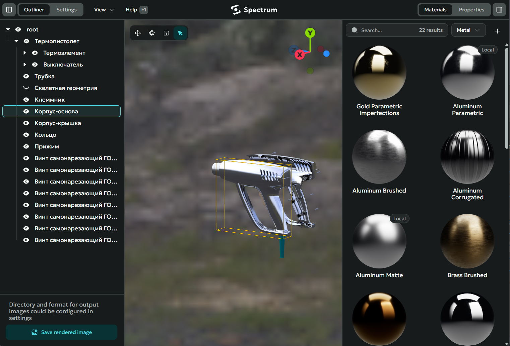

  <picture>
    <source media="(prefers-color-scheme: dark)" srcset="assets/logo-light.svg">
    
  </picture>

  <picture>
    <source srcset="assets/window.png">
    
  </picture>

[English](README.md) · [Русский](README.ru.md)

**Spectrum** is a photorealistic rendering application for KOMPAS-3D, developed by [Softellion](https://www.softellion.com). Send an assembly from your CAD system in one click and get an image — with an interactive preview, a material library, and controllable lighting.

## Contents

- [Features](#features)
- [System Requirements](#system-requirements)
- [Installation](#installation)
- [Your first render](#your-first-render)
- [Camera and selection controls](#camera-and-selection-controls)
- [Licensing](#licensing)
- [Known limitations](#known-limitations)
- [FAQ / Troubleshooting](#faq--troubleshooting)
- [Uninstall](#uninstall)
- [Support](#support)
- [Changelog](#changelog)
- [License](#license)

## Features

- **KOMPAS-3D integration.** The plugin exports the current assembly, and the scene appears in Spectrum automatically.
- **GPU rendering.** Ray tracing for maximum image quality.
- **Material library.** Materials from AMD GPUOpen with search, category filter, and automatic download on apply.
- **Custom materials.** Support for `.mtlx` (MaterialX) files — add your own materials through the upload dialog.
- **Image-based lighting.** Replace the built-in environment with an HDR panorama — it changes both lighting and reflections.
- **Scene editing.** Object tree from KOMPAS-3D, transform gizmo (translate / rotate / scale), and a properties panel for the selected object.
- **Quality presets.** Render settings are grouped into tabs with presets; changes are saved automatically and applied to the active render.

## System Requirements

| Component | Requirement |
|-----------|-------------|
| OS | Windows 10/11 (x64) |
| GPU | AMD or NVIDIA, up-to-date drivers |
| CAD | KOMPAS-3D **v23 or newer** (for model export) |
| Internet | required for downloading materials from the AMD GPUOpen library |
| Disk | an install folder with write access (materials are downloaded next to the program) |

## Installation

There is no installer — the distribution ships as a portable archive.

1. **Unpack the archive.** Download `spectrum_vX.Y.zip` from the [Releases](https://github.com/softellion/spectrum-pack/releases) page and extract it to a folder with write access, e.g. `C:\Users\<user>\Spectrum`.
2. **Connect the plugin in KOMPAS-3D.** Open the Applications menu and point it to `spectrum.kompas3d.rtw` from the unpacked folder — the plugin ships as this single file.
3. **Launch Spectrum.** Run `spectrum.exe`. Spectrum must be running before you export from KOMPAS-3D — otherwise the plugin reports that Spectrum is unavailable.

## Your first render

1. **Import a model.** Use the Spectrum plugin command in KOMPAS-3D to export the current assembly — the scene appears in Spectrum automatically.
2. **Frame the view.** Orbit and pan the camera until the model is positioned the way you want.
3. **Apply materials.** Select objects (click in the viewport or in the scene tree) and apply a material from the library.
4. **Save the result.** Right-click → **Save rendered image**.

Full documentation is available in the application itself: press **F1**.

  <video src="assets/demo.webm" controls muted playsinline width="800"></video>

## Camera and selection controls

| Action | Control |
|---------|---------|
| Select an object | left click |
| Add to selection | Ctrl + left click |
| Move camera | middle button + drag |
| Rotate camera | right button + drag |
| Zoom | mouse wheel |
| Context menu | right click without dragging |

The transform gizmo appears when exactly one object is selected; modes: **T** — translate, **R** — rotate, **S** — scale. For the full list of keyboard shortcuts, see the built-in help (F1).

## Licensing

The distributed package is a **trial version** with the following limitation:

- saving the rendered image is limited to **720p**.
- application screenshots are blocked.

For a full version, contact [contact@softellion.com](mailto:contact@softellion.com).

## Known limitations

- **Application state is not persisted between launches.** When Spectrum closes, the scene and applied changes are reset — the assembly has to be exported from KOMPAS-3D again.

## FAQ / Troubleshooting

**Windows SmartScreen or antivirus warns about spectrum.exe.**
The executable is not digitally signed, so Windows may show a warning. Click "More info" → "Run anyway". Download the archive only from the official [Releases](https://github.com/softellion/spectrum-pack/releases) page of this repository.

**The plugin reports that Spectrum is unavailable.**
Launch `spectrum.exe` before exporting from KOMPAS-3D — the plugin connects to a running Spectrum instance only.

**The material library does not load.**
The library is loaded from AMD GPUOpen and requires an internet connection (access to `api.matlib.gpuopen.com`). The panel shows a network error with a Retry button; loading also resumes automatically once the connection is back.

**Render fails, a black viewport, or poor performance.**
Make sure you have an AMD Radeon or NVIDIA GPU with up-to-date graphics drivers.

Other questions — see the built-in help (**F1**) or [contact us](#support).

## Network usage

Spectrum accesses the internet only to download materials from AMD GPUOpen (`api.matlib.gpuopen.com`, `images.matlib.gpuopen.com`) and to open links from the built-in help in your browser. No telemetry is collected.

## Uninstall

1. Remove the plugin in KOMPAS-3D (Applications menu).
2. Delete the unpacked folder — downloaded materials and cache are stored inside it, so no traces remain elsewhere.

## Support

- **Website** — [softellion.com/en/products/spectrum](https://www.softellion.com/en/products/spectrum)
- **Email** — [contact@softellion.com](mailto:contact@softellion.com)
- **Bug reports and suggestions** — [Issues](https://github.com/softellion/spectrum-pack/issues)

## Changelog

See [CHANGELOG.md](CHANGELOG.md).

## License

Spectrum is proprietary software by SOFTELLION. Terms of use: [EULA.md](EULA.md). Notices for third-party components: [THIRD-PARTY-NOTICES.md](THIRD-PARTY-NOTICES.md).

---

**Spectrum** by SOFTELLION — photorealistic rendering for KOMPAS-3D
